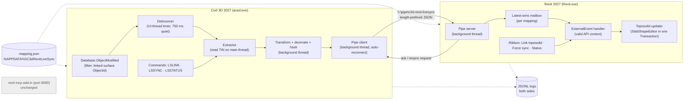

# Civil 3D → Revit Live Surface Sync — Plan (Phase 1)

Status: **plan approved in principle — open questions answered (§5)**. No code has been written yet.

## 1. What was verified on this machine (2026-10-10)

| Item | Finding | How verified |
|---|---|---|
| Civil 3D | **Civil 3D 2027** (`AeccDbMgd.dll` 13.9.628), installed under `C:\Program Files\Autodesk\AutoCAD 2027\C3D`. AutoCAD 2025/2026 are present but have **no** Civil 3D (object enablers only). | file system + file version |
| Revit | **Revit 2027** (`RevitAPI.dll` 27.2.0.39). Only version installed. | file version |
| .NET target | Both hosts run **.NET 10** (`tfm: net10.0` in their `*.runtimeconfig.json`). Plugins target `net10.0-windows`. SDK 10.0.303 installed. | runtimeconfig + `dotnet --list-sdks` |
| Toposolid API | Present (2024+). `Toposolid.Create(doc, IList<XYZ>, typeId, levelId)`, `Create(doc, IList<CurveLoop>, IList<XYZ>, typeId, levelId)`, `GetSlabShapeEditor()`, `SketchId`, `Simplify(double)`. `SlabShapeEditor.ResetSlabShape/Enable/AddPoints(IList<XYZ>)`. | `RevitAPI.xml` 2027 (Nice3point.Revit.Api.RevitAPI) |
| Civil surface API | `TinSurface.GetTriangles(bool includeInvisible)`, `Vertices`, `TinSurfaceTriangle.Vertex1..3`, `TinSurfaceVertex.Location`; `Surface.IsOutOfDate`, `AutoRebuild`, `Rebuild()`. | reflection over the installed `AeccDbMgd.dll` (no XML docs ship with C3D) |
| AutoCAD events | `Database.ObjectModified`, `DBObject.Modified`, `Document.CommandEnded/CommandWillStart/CommandCancelled`, `Application.Idle`. | reflection over `acdbmgd.dll`, `accoremgd.dll` |
| Civil units/transform | `SettingsDrawing.UnitZoneSettings.DrawingUnits`, `.CoordinateSystemCode`; `TransformationSettings` (grid scale, rotation). | reflection |
| Revit MCP | `mcp-servers-for-revit` (monorepo replacing the archived `revit-mcp`). **Built and installed for Revit 2027** (see §3). | built from source |

## 2. Architecture



### 2.1 Civil 3D plugin (`src/Civil3dPlugin`, NETLOAD)

- **Detection.** Subscribe to `Database.ObjectModified` and compare `e.DBObject.ObjectId` with the linked surface id. This is a cheap equality check, so it is safe to leave on. Civil 3D rewrites the surface object whenever it rebuilds: point add/move, breakline edit, definition change, and a corridor rebuild that feeds a surface. So this one event covers every edit path. *Why not `DBObject.Modified` on the opened surface?* That ties the subscription to one opened object instance. The database-level event survives the surface being closed and reopened, and it works for several mappings later.
- **Debounce.** The event only stamps `lastModifiedUtc` and sets a dirty flag. A `System.Windows.Forms.Timer` created on the AutoCAD main thread ticks every ~100 ms. Once 750 ms (configurable) have passed since the last change and no command is in progress (`Document.CommandInProgress == ""`, which keeps a grip-drag from syncing halfway), it extracts the surface. *Why a UI-thread timer?* AutoCAD objects may only be read on the main thread. `Application.Idle` alone is unreliable because it stops firing when AutoCAD is completely idle. A thread-pool timer would need marshalling back to the main thread anyway.
- **Extraction (main thread, `LockDocument` + read-only transaction).** Skip the sync and log a warning if `IsOutOfDate && !AutoRebuild`. Read the vertex positions plus the visible triangles as index triples. This is fast (≈ms for thousands of points), and the heavy work happens after it.
- **Background thread.** Converts units, applies the optional decimation, computes the hash, serialises the payload and writes it to the pipe. No AutoCAD objects are touched here (the same lesson as the COM work: never share host objects across threads).
- **Commands:** `LSLINK` (pick a surface and write its mapping entry), `LSSYNC` (force sync now, ignoring the hash), `LSSTATUS` (pipe state, last version, last latency), `LSUNLINK`.

### 2.2 Revit receiver (`src/RevitReceiver`, separate `.addin`)

- **Pipe server** on a background thread. It reads framed messages and drops each one into a *latest-wins* mailbox keyed by mapping id, so if Civil sends v12 and v13 while Revit is busy, only v13 is applied. It then calls `ExternalEvent.Raise()`.
- **ExternalEvent handler** (`IExternalEventHandler.Execute`) runs in a valid API context:
  1. Find the open document whose path matches the mapping. Revit can have several documents open, so this does not rely on the active one.
  2. Resolve the toposolid by `UniqueId`, falling back to `ElementId`.
  3. Run one `Transaction("LiveSync: <surface> v<N>")`, which gives one undo step per sync. Inside it: `editor.ResetSlabShape()` → `editor.Enable()` → `editor.AddPoints(points)`. The `ElementId`, type, material, sub-divisions and hosted elements stay the same because the element is never deleted.
  4. An `IFailuresPreprocessor` swallows harmless warnings, so a modal dialog doesn't block the loop.
  5. Send an ack back over the pipe with the timings. Civil 3D logs the true round-trip latency.
- **Ribbon:** *Link toposolid* (pick a toposolid, or create one from the next payload), *Force sync* (asks Civil for a fresh payload; if Civil isn't connected, re-applies the last cached payload), *Status*.
- **Important limitation:** a Revit toposolid's top face is **re-triangulated by Revit from the points**. Civil 3D triangles and breaklines are not honoured exactly. We send the triangles anyway, both for hashing and for a possible future exact-mesh mode. See open question Q4.
- **Boundary:** `AddPoints` requires the points to lie *inside the toposolid's sketch boundary*. When the Civil outline changes, the sketch is rewritten in place with `SketchEditScope` (see §5, Q3). If that fails, the outside points are dropped and a warning is logged.

### 2.3 Transport — separate named pipe, *not* port 8080

I read the MCP add-in's `SocketService.cs`. Reusing 8080 for surface payloads is a poor fit:

1. **No message framing.** It does a single `stream.Read` into an **8 KB buffer** and treats that as one JSON message. A surface payload of a few hundred KB would be split and fail to parse.
2. **It binds `IPAddress.Any`.** Port 8080 is reachable from the LAN, and the same socket accepts `send_code_to_revit` (arbitrary C#). We should not add to that, and you may want it changed to `IPAddress.Loopback` (not done — it's your server).
3. **It blocks the socket thread** while each command waits for its ExternalEvent. A busy sync would stall MCP calls, and the reverse is also true.
4. **The pipe is local-only by design.** Named pipes are restricted to the current user by ACL, need no port or firewall prompt, and are full-duplex for acks and resync requests.

The pipe is `\\.\pipe\c3d-revit-livesync` and each message is a **4-byte little-endian length + UTF-8 JSON**. Revit is the server and Civil 3D is the client, which reconnects every 2 s when Revit isn't up.

**Reuse from the MCP add-in:** its ExternalEvent wrapper and logger patterns, but not its code or socket. A later `livesync_status` MCP command (Phase 2+, with your approval) could read our status file, so AI can summarise what changed without being in the real-time loop.

### 2.4 Message format (v1)

```jsonc
{
  "type": "surface.update",          // also: "ping", "ack", "resync.request", "error"
  "schema": 1,
  "mappingId": "eg-site",
  "source": { "app": "Civil3D 2027", "dwg": "C:\\...\\Site.dwg", "handle": "2A7F", "name": "EG" },
  "version": 14,                     // monotonic per mapping, persisted in mapping state
  "sessionId": "b5c…",               // changes each NETLOAD; lets Revit detect a restart
  "hash": "sha256:…",                // over quantised vertices + triangles (1e-6 of a unit)
  "units": "ft",                     // "m" | "ft" | "usft" — units of the coordinates below
  "frame": "shared",                 // coordinates are in Revit shared coords (Civil world XY)
  "vertices": [x0, y0, z0, x1, y1, z1, ...],   // flat array
  "triangles": [i0, i1, i2, ...],              // flat index array, visible triangles only
  "decimated": false,
  "timing": { "lastEditUtc": "…", "extractedUtc": "…", "sentUtc": "…" }
}
```

The ack from Revit contains `{type:"ack", mappingId, version, status:"applied|skipped-same-hash|error", pointsApplied, pointsDropped, timing:{receivedUtc, eventStartUtc, committedUtc}}`.

Hashing happens on **both** sides. Civil 3D skips the send if the hash equals the last *acked* hash, and Revit skips the apply if the hash equals the hash it last applied (for example after Revit restarts and Civil re-sends).

### 2.5 Coordinates and units

- **Civil side:** the payload keeps raw world coordinates plus the drawing unit (`UnitZoneSettings.DrawingUnits`). No conversion happens in Civil 3D, so its job stays simple.
- **Revit side:** `internal = inverse(doc.ActiveProjectLocation.GetTotalTransform()) × toFeet(shared)`. This assumes Revit's shared coordinates match the Civil 3D world coordinates, which is the normal "Acquire Coordinates" setup. The mapping file can add an extra offset, rotation or elevation datum. `GetTotalTransform()` is inherited from `Instance`. I'll confirm it at implementation (step 6).
- US survey foot vs international foot: 1 usft = 1200/3937 m. This matters at state-plane magnitudes (≈2 ppm), so it is explicit in the config.

### 2.6 Mapping file

Location: `%APPDATA%\C3dRevitLiveSync\mapping.json` (shared by both apps). An example is in `config/mapping.example.json`:

```jsonc
{
  "pipeName": "c3d-revit-livesync",
  "debounceMs": 750,
  "logDir": "%APPDATA%\\C3dRevitLiveSync\\logs",
  "mappings": [{
    "id": "eg-site",
    "civil": { "dwgPath": "C:\\Projects\\Site.dwg", "surfaceHandle": "2A7F", "surfaceName": "EG" },
    "revit": { "documentPath": "C:\\Projects\\Site.rvt", "toposolidUniqueId": "…", "elementId": 123456 },
    "transform": { "units": "ft", "offset": [0,0,0], "rotationDeg": 0 },
    "decimation": { "enabled": false, "maxPoints": 20000 }
  }]
}
```

The surface is identified by **handle** (stable across sessions in the same DWG), with the name as a human-readable fallback. The toposolid is identified by **UniqueId** (stable across worksharing and save-as), with the ElementId as a fallback.

### 2.7 Logging and latency

Both sides write JSONL logs (`civil3d-YYYYMMDD.jsonl`, `revit-YYYYMMDD.jsonl`). Each line has a UTC timestamp at 0.1 ms resolution, the `mappingId`, the `version` and the stage. **End-to-end latency = Revit `committedUtc` − Civil `lastEditUtc`**. Both run on the same machine, so they share a clock. Civil 3D prints one summary line per sync to the command line, for example: `LiveSync EG v14: 312 pts, sent 18 ms, applied in Revit 1.21 s after edit`.

Expected budget: debounce 750 ms + extract <50 ms + pipe <5 ms + ExternalEvent wait (only when Revit is idle; it waits if you're mid-command in Revit) + toposolid regen (unknown — **measuring this is step 5**). For a few hundred points the total should be ~1–1.5 s.

### 2.8 Decimation (off by default)

The grid-binning reducer keeps one vertex per XY cell (the one closest to the cell's mean Z), always keeps the surface's boundary vertices, and adapts the cell size until the point count is ≤ `maxPoints`. A separate option is the Revit-side `Toposolid.Simplify(pct)`, which exists in the 2027 API but runs after the full apply, so it doesn't save time.

### 2.9 Designed for later phases (not built now)

- `"type"` drives a handler registry on the Revit side (`surface.update` → `ToposolidHandler`). Later kinds would be `corridor.update` and `family.changed`.
- On the Civil side an `ISyncSource` interface (`Watch`, `Extract`) sits behind the debouncer. A corridor source is just another implementation.
- SolidWorks and Inventor would be **separate client processes** connecting to the same pipe. Inventor 2025–2027 is already installed. Revit gets a `family.changed` message and shows a notification. No change to the transport.
- Revit → Civil 3D: the pipe is already duplex, and the message types are reserved.

## 3. Revit MCP install (done, as requested)

- `revit-mcp` is archived and contains only the Node server. Its README points to the monorepo **`mcp-servers-for-revit`**, which contains the server, the Revit plugin and the command set. That is what I installed.
- Upstream supports Revit 2020–2026 only. On a local branch `revit2027` of `C:\Users\bhavs\source\repos\mcp-servers-for-revit` (commit `cd6c423`, not pushed) I:
  - added `Debug R27`/`Release R27` configurations (`net10.0-windows10.0.19041.0`);
  - fixed the one API break: **Revit 2027 removed `Curve.Intersect(Curve, out IntersectionResultArray)`**. I used `Intersect(Curve, CurveIntersectResultOption.Detailed)` + `GetOverlaps()` under `REVIT2027_OR_GREATER`.
- Built `Release R27` and copied the add-in to `%APPDATA%\Autodesk\Revit\Addins\2027\` (`mcp-servers-for-revit.addin` + `revit_mcp_plugin\`).
- Built the Node server (`server/build/index.js`) and registered it in Claude Code (user scope) as `mcp-server-for-revit`.
- **Still to do by you:** start Revit 2027 → click *Always Load* → ribbon *Settings* → enable the commands → *Save* → click *Revit MCP Switch* to start listening on 8080. This hasn't been tested inside Revit yet, because Revit wasn't running.

## 4. Build steps (each ends with a manual test you run)

| # | Step | You test |
|---|---|---|
| 0 | Repo skeleton, docs, `.gitignore`, shared `LiveSync.Shared` (message models, framing, hash) + unit tests | `dotnet test` passes |
| 1 | Civil plugin: NETLOAD, `LSLINK`, `LSSTATUS`; logs modification events with debounce (no sending) | Edit a 300-pt surface → see one "debounced change" line per edit, not hundreds |
| 2 | Civil plugin: extraction + hash + JSON dump to a file (`LSSYNC` writes `payload.json`) | Point count matches Surface Properties → Statistics |
| 3 | Revit receiver: `.addin`, pipe server, logs received messages; a test console app sends a canned payload | Revit log shows receipt; no UI freeze |
| 4 | Revit: ExternalEvent + in-place toposolid update from a canned payload | Toposolid shape changes, same ElementId, one undo step |
| 5 | Connect the two ends + acks + latency logging | Edit in C3D → Revit updates in ≤2 s; latency line in the C3D command line |
| 6 | Coordinates/units + mapping file + boundary handling | Toposolid lands exactly on a known spot elevation |
| 7 | Decimation option, force-sync buttons, reconnect robustness, `SETUP.md` from a clean machine | Larger surface (10k–50k pts) timings recorded in `TESTING.md` |

I'll make one git commit per step.

## 5. Answers (2026-10-10) and their effect on the design

| Q | Answer | Design consequence |
|---|---|---|
| 1 Repo location | **Keep in OneDrive** | `Directory.Build.props` sends `bin/` + `obj/` to `%LOCALAPPDATA%\C3dRevitLiveSync\build\`, so OneDrive never syncs build output or locked DLLs. Deploy scripts copy from there. |
| 2 Units | **Metric (m)**, shared coordinates assumed acquired from the DWG | `units:"m"` by default; Revit converts m → ft with `UnitUtils`. `SETUP.md` includes a "verify shared coordinates" check using a known spot elevation. |
| 3 Boundary | **Rewrite the sketch in place** | Step 6: `SketchEditScope.Start(toposolid.SketchId)`, then a `Transaction` that replaces the sketch's boundary curves with the Civil outer boundary (computed from TIN edges that belong to only one triangle), then `scope.Commit(preprocessor)` and then the point update. The docs say `SketchEditScope` must start with *no* transaction open, so it runs as its own phase in the ExternalEvent handler, before the point transaction. That means two undo steps per sync when the boundary changes, and one otherwise. Fallback if the sketch commit fails: warn and drop the outside points. |
| 4 Exactness | **Densify breaklines** | Civil side reads `TinSurface.BreaklinesDefinition` → `SurfaceBreakline.Vertices` (verified) and adds points every *d* metres along each breakline segment (config `breaklineDensify`, in drawing units, default 1.0). The TIN vertices are already on the breaklines, so only the in-between points are new. |
| 5 Test data | **Generate** | I write `testdata/small-site.xml` (LandXML, ~300 pts, 2 breaklines, metric) plus steps to build `Site.dwg` and a metric Revit project. |
| 6 Revit packaging | **Separate add-in** | `src/RevitReceiver` gets its own `.addin`; the MCP add-in is untouched. |
| 7 Git | **Local only** | `git init` here; no remote. |

## 6. Original open questions (answered above)

1. **Repo location.** This folder is inside **OneDrive**. Git plus `bin/obj` churn inside OneDrive tends to cause sync conflicts and locked files, and AutoCAD/Revit lock loaded DLLs. Should we move the repo to `C:\Users\bhavs\source\repos\Civil3dRevitLiveSync` (recommended), or keep it here?
2. **Coordinates.** Has your Revit test project acquired shared coordinates from the Civil 3D DWG, so that Civil world X,Y equals Revit shared E/N? Are your drawings metric (m) or imperial, and if imperial, international ft or US survey ft?
3. **Boundary changes.** When the Civil surface outline changes, what should happen? (a) warn and drop points outside the toposolid (phase-1 default); (b) also rewrite the toposolid sketch via `SketchEditScope` (keeps the ElementId, more work and more risk); (c) delete and recreate (loses the ElementId and hosted elements).
4. **Exactness.** Revit re-triangulates toposolid points, so breaklines won't be honoured exactly. Is that acceptable for phase 1? Alternatives: densify points along breaklines (cheap, much better ridges and ditches), or a parallel exact-mesh `DirectShape` mode (exact triangles, but not a toposolid, so no hosting or sub-divisions).
5. **Test data.** Do you have a small test DWG with a TIN surface (a few hundred points) and a matching Revit project? If not, I'll generate both: a surface from a LandXML file I write, and a Revit project with a toposolid.
6. **Revit receiver packaging.** I recommend a **separate small add-in** rather than adding the pipe to the MCP plugin. It keeps your MCP server untouched and the sync loop independent of it. OK?
7. **Git remote.** Should commits stay local, or should I also push to a GitHub repo? (The GitHub MCP connection failed this session; `gh` could be used if it's logged in.)
